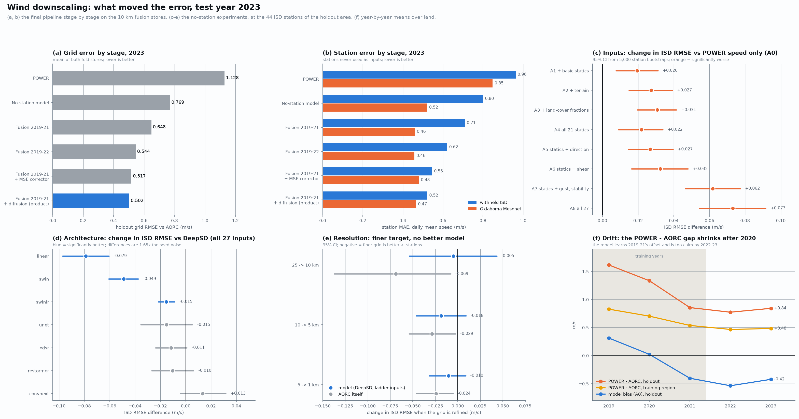
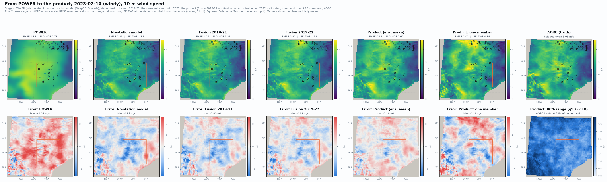
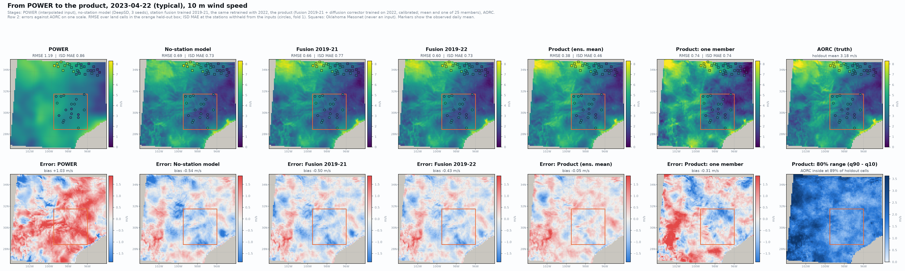
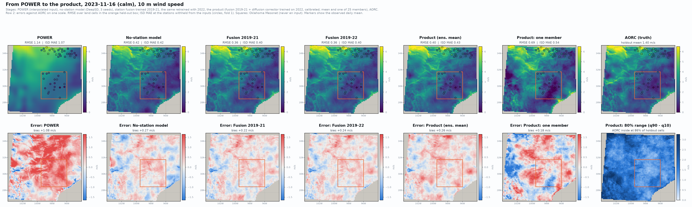
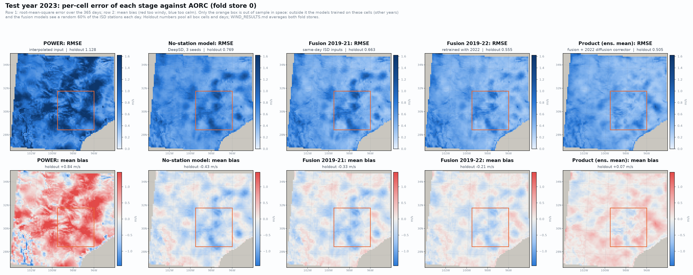
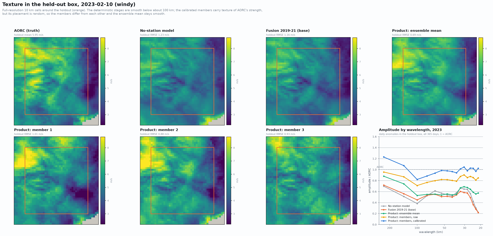
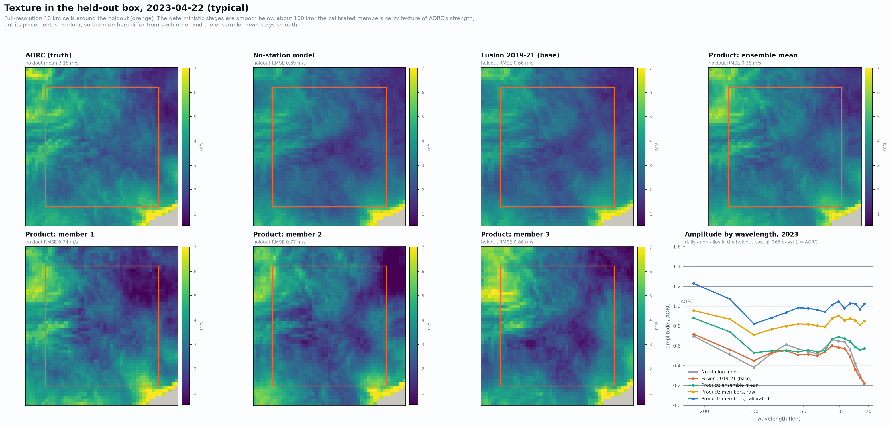
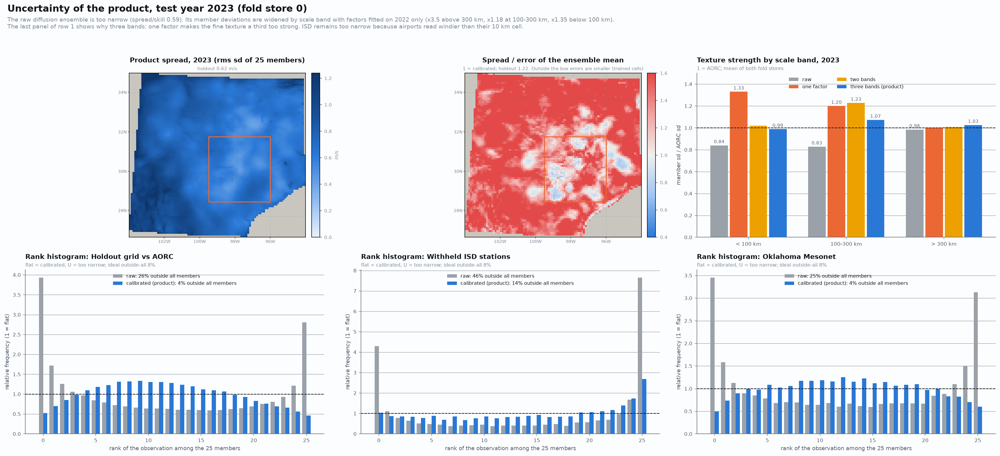

# Wind downscaling: results

Status 16 November 2026. All experiments are finished. This file collects every result in one place; the full method,
job ledger and reasoning are in `WIND_WORK_LOG.md` (section numbers given as "log 7d" etc.).

## In one paragraph

NASA POWER daily 10 m wind speed (about 50 km) was downscaled to 10 km over the South-Central US against AORC. A
network that sees only POWER cuts the held-out grid error from 1.13 to 0.77 m/s, but beats interpolated POWER at
stations only narrowly, and no input, architecture, training target or finer grid changes that. What changed it was
(1) same-day ISD station observations as inputs, (2) a second-stage corrector trained on the model's errors in the most
recent year, which also absorbs a drift between POWER and AORC, and (3) a residual diffusion model with a scale-aware
spread calibration that gives a calibrated 25-member ensemble with realistic texture. The product reaches
**0.50 m/s grid RMSE** and **0.52 m/s MAE at withheld stations** (POWER 1.13 and 0.96), with grid CRPS 0.27.

## Setup

| | |
|---|---|
| Input | NASA POWER WS10M daily, interpolated to the target grid (plus, by experiment, other POWER fields and 21 static maps) |
| Target | AORC daily mean 10 m speed, 10 km (EPSG:5070, 93 x 100 cells); also 25, 5, 1 km rungs and ERA5-Land |
| Years | train 2019-21, validation 2022, test 2023 |
| Space | Austin holdout box (1,295 land cells) never trained on; scores are over the box only |
| Stations | ISD airports: 190 in the domain, 42 in the holdout split into two folds of 21. In fold store f, fold f's stations are inputs and the other fold is scored. Oklahoma Mesonet (30 stations, never an input, outside the box: temporally independent only) |
| Metrics | RMSE and bias against AORC on the grid; station MAE / RMSE; ensemble CRPS, spread/skill, 80% coverage, rank histograms; amplitude and r2 by scale band (< 100, 100-300, > 300 km) |

## 1. The final pipeline, stage by stage (test year 2023, mean of both fold stores)

`outputs/wind/results_stage_scores.json`; figure `results_findings.png` (a, b).

| Stage | Grid RMSE | Grid bias | Withheld ISD MAE | Mesonet MAE |
|---|---|---|---|---|
| POWER, interpolated | 1.128 | +0.84 | 0.963 | 0.848 |
| No-station model (DeepSD, ladder inputs, 3 seeds) | 0.769 | -0.43 | 0.800 | 0.521 |
| Station fusion, trained 2019-21 (3 seeds) | 0.648 | -0.32 | 0.709 | 0.460 |
| Station fusion, trained 2019-22 (3 seeds) | 0.544 | -0.19 | 0.621 | **0.458** |
| Fusion 2019-21 + MSE corrector trained on 2022 | 0.517 | +0.07 | 0.546 | 0.480 |
| **Fusion 2019-21 + diffusion corrector on 2022 (product, ensemble mean)** | **0.502** | +0.09 | **0.522** | 0.466 |

Further references (log 7d): AORC itself at withheld ISD has de-biased RMSE 0.31 (the ceiling); kernel interpolation
of station departures over POWER 0.52 de-biased; no-station model + kernel-spread station residuals ("hybrid") grid
0.62.



### Why two stages (log 7d, two-stage control)

The corrector is trained on the 2019-21 network's out-of-sample errors in 2022. Retraining the network on 2019-22
instead gets about 70% of the grid gain but less at stations, and the corrector also beats the retrained network after
an oracle removes that network's 2023 bias:

| | Grid RMSE | Withheld ISD MAE | Mesonet MAE |
|---|---|---|---|
| network 2019-22 | 0.544 | 0.621 | 0.458 |
| network 2019-22 minus its own 2023 bias (oracle, not achievable) | 0.511 | 0.579 | 0.482 |
| network 2019-21 + diffusion corrector on 2022 | **0.502** | **0.522** | 0.466 |

So the corrector learns where and when the network is wrong, not only the level. About 90% of the corrector's gain is
also obtained by a deterministic network trained with MSE on the same residuals (0.517); diffusion adds 2-5% and the
ensemble. For a 2024 product the recipe moves one year: network on 2019-22, corrector on 2023.

## 2. Maps

All maps are in `outputs/wind/maps/` (PNG, not tracked by git; regenerate with the commands at the end). The results
sheets use fold store 0, so the circles are fold-1 ISD stations withheld from the inputs.

### One day through the pipeline

Windy (2023-02-10), typical (2023-04-22) and calm (2023-11-16) days: POWER, no-station model, fusion 2019-21, fusion
2019-22, product ensemble mean, one calibrated member, AORC; row 2 the errors and the product's 80% range.





On the windy day all deterministic stages are 0.6-0.9 m/s too calm over the holdout; the corrector removes most of it
(holdout RMSE 1.16 -> 0.69). The withheld airports on that day are better matched by POWER than by any model,
a reminder that a single day at 21 stations is noisy.

### The whole test year



The no-station and first fusion models are too calm in round patches 50-80 km across over the holdout (the size of
the station kernels); the 2019-22 network shrinks them, the product removes them and is slightly windy instead (+0.07
on fold store 0).

### Texture




Deterministic stages carry 40-60% of AORC's amplitude below 100 km. Calibrated members match it (about 1.0 from 300 km
down to 20 km), but their fine structure is not placed: r2 with AORC below 100 km is about 0.07 per member and 0.19 for
the deterministic fields. Placing it would need information POWER and the stations do not have (log 7c).

### Uncertainty



### Earlier sheets (still valid)

| Sheet | Shows |
|---|---|
| `inference_<run>_<day>.png`, `testyear_<run>.png` | each no-station run: POWER, AORC, model, correction made vs needed, station circles; 2023 bias and RMSE |
| `inputs_<store>_<chan>_<day>.png` | every input channel on a day |
| `ladder_<day>.png` | 25, 10, 5 and 1 km on the same day (the 1 km rows: job 1147372) |
| `loro_<day>.png` | west, coast and north holdouts |
| `diffusion_obsvalcal3_<day>.png`, `diffusion_obsvalcal3_testyear.png` | product members, spread, rank histograms |
| `inference_w10o0_*`, `testyear_w10o0_*` | fusion runs, including `w10o0_LO4y_s1337` (trained 2019-22) |

## 3. Calibrated ensemble (log 7d)

The raw diffusion ensemble is too narrow. Member deviations from the ensemble mean are widened per scale band with
factors fitted on out-of-fold 2022 only (two cross-fit models on odd and even months), then 2023 is scored once.

| 2023, mean of folds | Factors (fitted on 2022) | Grid CRPS | Spread/skill | ISD CRPS | ISD cover80 | Meso CRPS | Meso cover80 | Member amplitude < 100 / 100-300 / > 300 km |
|---|---|---|---|---|---|---|---|---|
| raw | 1 | 0.289 | 0.59 | 0.411 | 0.38 | 0.343 | 0.52 | 0.84 / 0.83 / 0.98 |
| one factor | 2.05 | 0.273 | 1.20 | 0.368 | 0.67 | 0.325 | 0.84 | 1.33 / 1.20 / 1.00 |
| two bands | 2.4 / 1.17 | 0.273 | 1.20 | 0.368 | 0.67 | 0.324 | 0.82 | 1.02 / 1.23 / 1.01 |
| **three bands (product)** | 3.5 / 1.18 / 1.35 | **0.273** | 1.21 | **0.367** | 0.69 | **0.324** | 0.81 | **0.99 / 1.07 / 1.03** |

- Three bands give the same CRPS as one factor with the texture at the right strength in every band.
- Slightly too wide in 2023 (1.21; on 2022 out-of-fold it was 1.00): the half-year models used for fitting are a bit
  worse than the full-year model.
- Withheld ISD coverage stays at 0.69 against 0.80: airports read windier than their 10 km cell, a representativeness
  gap a gridded ensemble should not absorb.
- A 5-seed ensemble of deterministic networks is not a usable uncertainty: station spread 0.07-0.16 m/s against a
  station error of about 0.8; 90% coverage needs intervals 3.2-3.9 m/s wide (station CRPS 0.73-0.80).

## 4. What did not help (no-station experiments, log 7, 7e)

All at the 44 ISD stations of the holdout area, 2023, raw RMSE; differences are paired station bootstraps (5,000),
95% CI. Figure `results_findings.png` (c-f).

### Inputs (Q2): less is better

| Set | ISD RMSE | vs A0 | Grid RMSE | Grid after same-day offset |
|---|---|---|---|---|
| A0 POWER speed only (4 channels) | **0.947** | | **0.772** | 0.569 |
| A1 + basic statics | 0.966 | +0.020 [+0.008, +0.031] | 0.785 | 0.572 |
| A4 all 21 statics | 0.969 | +0.022 [+0.009, +0.034] | 0.783 | 0.568 |
| A5 + direction | 0.973 | +0.027 [+0.014, +0.040] | 0.780 | 0.562 |
| A6 + shear | 0.979 | +0.032 [+0.016, +0.048] | 0.808 | 0.570 |
| A7 + gust, stability | 1.009 | +0.062 [+0.047, +0.077] | 0.820 | 0.575 |
| A8 all 27 | 1.020 | +0.073 [+0.054, +0.092] | 0.833 | 0.572 |

Every addition makes stations worse; statics are neutral (A4 vs A1 +0.002). After the same-day offset correction all
sets tie, so the harm is in the level: richer inputs fit the 2019-21 level more tightly and carry more of the later
drift (offset share of MSE 0.29 for A0, 0.37 for A8).

### Architecture (Q1): capacity does not help

| vs DeepSD (A8) | ISD difference | 95% CI |
|---|---|---|
| linear | -0.079 | [-0.097, -0.061] |
| swin | -0.049 | [-0.061, -0.038] |
| swinir | -0.015 | [-0.022, -0.009] |
| unet / edsr / restormer / convnext | -0.015 to +0.013 | all include 0 |

The linear model is best at stations with almost no fine texture (amplitude below 60 km 0.09 of AORC's vs 0.53 for
DeepSD). Architecture differences are only 1.65 times the seed noise.

### Training target (Q3)

ERA5-Land-trained vs AORC-trained at stations: -0.105 [-0.238, +0.026], not significant. ERA5-Land is smooth
(coherence resolution 102 km), so the ERA5-trained model's 0.33 grid RMSE is against an easy target. Scored against
AORC, the ERA5-trained model (0.778) beats the AORC-trained A8 (0.833), partly because it does not inherit AORC's drift.

### Resolution (Q5) and other regions (Q6)

| Step | Model at stations | AORC itself at stations |
|---|---|---|
| 25 -> 10 km | -0.005 [-0.054, +0.043] | **-0.069** [-0.137, -0.008] |
| 10 -> 5 km | -0.018 [-0.046, +0.009] | **-0.029** [-0.054, -0.002] |
| 5 -> 1 km | -0.010 [-0.032, +0.009] | **-0.024** [-0.046, -0.005] |

| Rung (DeepSD L) | Seeds | Grid | ISD | Mesonet | Amplitude < 60 km |
|---|---|---|---|---|---|
| 25 km | 5 | 0.763 | 0.971 | 0.668 | 0.47 |
| 10 km | 5 | 0.772 | 0.961 | 0.655 | 0.43 |
| 5 km | 5 | 0.761 | 0.941 | 0.641 | 0.48 |
| 1 km | 3 | 0.778 | 0.931 | 0.646 | 0.32 |

The target improves at every step, the model at none. Leave-one-region-out (west, coast, north holdouts, 10 -> 5 km)
agrees: no reliable gain in any region (north after offset correction -0.026 [-0.051, -0.003] is the one weak
exception). Grid scores are against each rung's own target and are not comparable across rungs.

### Daily offset (Q4)

A uniform same-day offset is 31% of the 10 km model's MSE. A ridge correction on 6 x 6 block means of the
training-region residual recovers 89% of what the true offset would: grid 0.772 -> 0.561 (oracle 0.535); ISD 0.961 ->
0.765. Recovery is lower in the moved holdouts (west 0.60, north 0.62, coast 0.80). Wind error is less local than the
plan assumed.

### Drift (Q7)

| Year | POWER - AORC, holdout | POWER - AORC, training region | Model bias (A0), holdout |
|---|---|---|---|
| 2019 | +1.62 | +0.83 | +0.31 |
| 2020 | +1.34 | +0.70 | +0.02 |
| 2021 | +0.86 | +0.54 | -0.40 |
| 2022 | +0.77 | +0.47 | -0.54 |
| 2023 | +0.84 | +0.48 | -0.42 |

Against all 190 ISD stations (`bias_years.md`), AORC gets windier (ISD - AORC +0.43 in 2019 to about +0.05 from 2021)
and POWER calmer (ISD - POWER -0.70 to -0.50). Of the model's 2023 grid bias, about 0.15 m/s is POWER's drift, which
stations can correct; the rest is AORC moving away from the stations, which a model trained against AORC inherits.
A model trained on 2019-21 learns an offset that is too big for later years, which is why the most-recent-year
corrector pays. Part of its grid gain is therefore following AORC, but its gain at withheld ISD stations (0.709 ->
0.522) shows it is not only that; the de-biased station scores in `obs_eval.md` are blind to both drifts.

### Second station network (Q8)

Conclusions hold at Oklahoma Mesonet (never an input): no-station model 0.52 MAE vs POWER 0.85; station fusion 0.46.
Mesonet has no drift problem, so the corrector does not help there (0.466) and the 2019-22 network is best (0.458).

## 5. Answers to the plan's questions

| | Question | Answer |
|---|---|---|
| Q1 | Does the architecture matter? | Barely. Linear is best at stations; differences are 1.65x seed noise. |
| Q2 | Which inputs carry the information? | POWER speed alone. Every other input hurts at stations through the level. |
| Q3 | Does the target set the ceiling? | Not detectably at stations; ERA5-Land is a much smoother target. |
| Q4 | How much is a uniform daily offset? | About 30% of MSE; a same-day block-mean correction recovers 89% of it. |
| Q5 | How far down does it pay to go? | Nowhere below 25 km for the model; AORC itself keeps improving. |
| Q6 | Do results hold in other regions? | Yes, no reliable 10 -> 5 km gain in any region. |
| Q7 | Why too low in 2023? | The POWER - AORC gap shrinks (POWER calmer, AORC windier relative to stations); the model learned 2019-21's offset. |
| Q8 | Do station results hold on Mesonet? | Yes, with the caveat that Mesonet lies outside the holdout box. |
| Q9 | Can a seed ensemble give calibrated intervals? | No (spread 10x too small). A residual diffusion ensemble with three-band calibration can. |

## 6. Caveats and open items

- **Texture below 100 km is realistic in amplitude but random in placement.** Stations are about 70 km apart and do not
  resolve it; HRRR/RTMA-type inputs would be needed.
- **AORC is not fully independent of ISD.** Its fine-scale wind correlates 0.88 with stations, which POWER and
  ERA5-Land cannot explain. It probably assimilates surface observations.
- **Mesonet lies in the training region.** It is temporally independent only, not spatially.
- **ISD coverage of the ensemble is 0.69** against the 0.80 target, because airports are windier than their cell.
- **The product depends on a recent year of AORC** for the corrector, and its benefit assumes next year drifts like the
  last one did.
- **Decision pending:** which variant the paper reports as the product.
  - Diffusion ensemble: best on the grid and at ISD, and calibrated.
  - MSE corrector: deterministic, 0.517.
  - Network trained on 2019-22: simplest, 0.544, best at Mesonet.
- **1 km store:** it has a 19% land-cover gap.

## 7. Reproduce

```bash
# on Vista, repo root (login node unless noted)
python scripts/wind_results_figs.py                    # results_* sheets, results_stage_scores.json (~10 min)
python scripts/wind_two_stage.py                       # two_stage.md (after the obs4 runs)
python scripts/wind_diffusion_calib.py --mode band3    # three-band calibration -> obsvalcal3, scores it
python scripts/wind_diffusion_maps.py --tag obsvalcal3 --control obsvaldet
sbatch --export=ALL,MAPARGS="--runs w1_L_s1337 --only ladder testyear" slurm/vista_wind_maps.sh   # 1 km sheets
# on the Mac
scp "vista2:/work/11755/gurup12/vista/downscaling/outputs/wind/maps/results_*.png" outputs/wind/maps/
```

| Result file | Content |
|---|---|
| `outputs/wind/results_stage_scores.json` | section 1 table, per fold and mean |
| `outputs/wind/two_stage.md` | two-stage control |
| `outputs/wind/obs_eval.md` | every fusion run and reference, bands and station scores |
| `outputs/wind/diffusion/*_score.json`, `obsval_calib*.json` | ensemble scores and calibration fits |
| `outputs/wind/wind_summary.md` | all no-station variants and paired comparisons |
| `outputs/wind/drift.json`, `bias_years.md` | drift |
